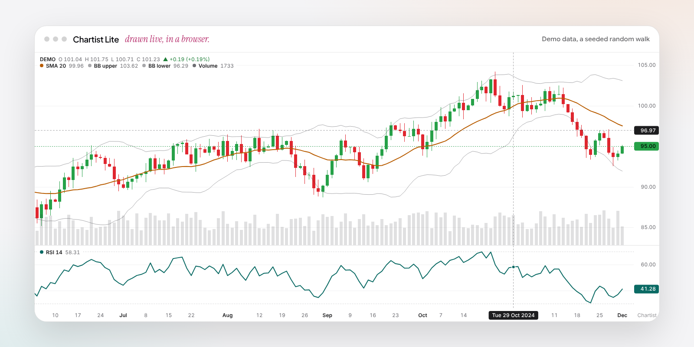
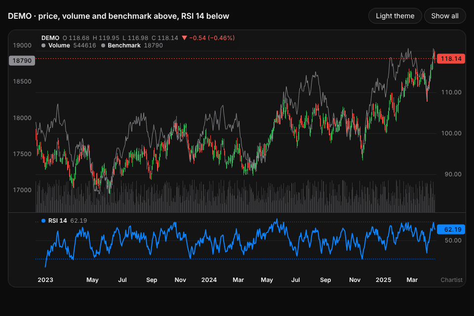
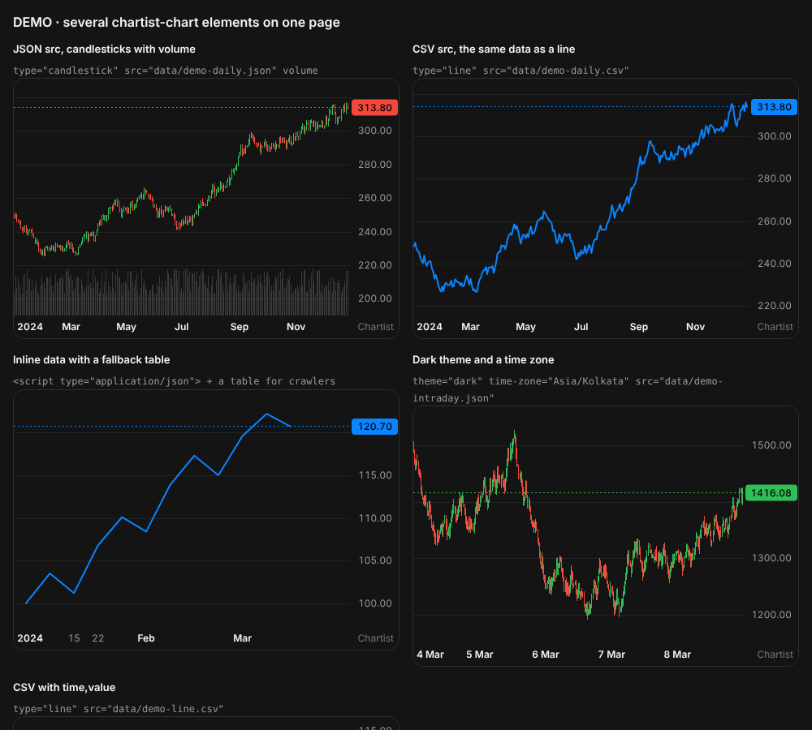

<h1 align="center">Chartist Lite</h1>

<p align="center"><strong>Financial charts that stay light.</strong> Candlesticks, indicators, stacked panes and exchange time zones on one canvas, with no runtime dependencies.</p>

<p align="center">    </p>

<p align="center"><picture><source media="(prefers-color-scheme: dark)" srcset="docs/screenshots/site-readme-hero-dark.png"></picture></p>

Chartist Lite is a small JavaScript library that draws price charts (candlesticks, bars, lines, areas, histograms and baselines) on a single canvas, with built-in indicators, stacked panes, exchange time zones and a legend. It comes as an ES module, a React wrapper and a `<chartist-chart>` web component.

**Status: version 0.1.0, not yet published to npm.** Build it from source for now (see [Install](#install)). Licence: Apache-2.0.

## Why

| | What you get | Measured or shown in |
|---|---|---|
| **Built for 120 Hz** | Highest p95 frame cost of any gesture: 6.50 ms of the 8.33 ms a 120 Hz frame allows, in 60 scenarios up to 100000 bars (headless Chromium, one machine) | [Performance](#performance), `docs/PERFORMANCE.md` |
| **Indicators built in** | 12 indicators, Heikin-Ashi and bar aggregation as plain functions in a 5.2 KB gzip entry, with live forms | [Indicators](docs/guide/indicators.md) |
| **Stacked panes** | RSI or MACD under the price, sharing the time axis and crosshair, with a divider you drag or move by keyboard | [Panes and scales](docs/guide/panes-and-scales.md) |
| **Exchange time, no gaps** | One slot per bar, so nights and weekends take no space; labels in any IANA zone, daylight saving included | [Time and time zones](docs/guide/time-and-time-zones.md) |
| **A tag, no code** | `<chartist-chart>` reads JSON or CSV, with fallback text that crawlers read | [Embedding the chart](docs/guide/embedding.md) |
| **Keyboard and screen reader** | Focusable chart with a name; Enter steps through bars, each announced through a live region | [Accessibility](docs/guide/accessibility.md) |
| **Safe on strict pages** | Works under `style-src 'self'`; hostile page CSS and right-to-left pages do not reach it (checked in Chromium) | [Embedding the chart](docs/guide/embedding.md) |
| **Numbers that read right** | A true minus sign (`−2.35`), no grouping commas (`12345.60`), tabular figures on the axes | [Time and time zones](docs/guide/time-and-time-zones.md) |
| **Small, no dependencies** | Core 32.6 KB gzip with nothing else to install; React is an optional peer dependency | [Sizes](#sizes) |

Drawing tools (trend line, ray, horizontal and vertical line, rectangle, Fibonacci retracement, measure, text) are being added as a separate entry; they are not part of 0.1.0 yet.

## Install

Once published:

```bash
npm install @mrchartist/chartist-lite
```

The package is not published yet, so today you build it and host the files yourself:

```bash
cd packages/chartist-lite
npm install
npm run build        # writes dist/
```

Copy the file you need from `dist/` next to your page: `chartist-lite.element.iife.min.js` for the web component, `chartist-lite.iife.min.js` for the global `ChartistLite`, `chartist-lite-indicators.iife.min.js` for the global `ChartistLiteIndicators`, or the ES modules for a bundler.

## Quick start

<details><summary>Script tag and the web component (no build step)</summary>

```html
<script src="chartist-lite.element.iife.min.js"></script>

<chartist-chart type="candlestick" theme="auto" src="/data/prices.json" height="360"
  time-zone="Asia/Kolkata" aria-label="Daily price"></chartist-chart>
```

The data can be a URL (JSON or CSV), an inline `<script type="application/json">` or a `.data` property. The chart is created when the element nears the viewport.

</details>

<details><summary>ES module and createChart</summary>

```js
import { createChart, CandlestickSeries, LineSeries } from '@mrchartist/chartist-lite';
import { sma } from '@mrchartist/chartist-lite/indicators';

const chart = createChart('chart', { theme: 'auto', ariaLabel: 'Daily price' });
const candles = chart.addSeries(CandlestickSeries, { title: 'DEMO' });
const average = chart.addSeries(LineSeries, { title: 'SMA 20', lineWidth: 2 });

candles.setData(bars);          // [{ time: '2024-01-02', open, high, low, close }, ...]
average.setData(sma(bars, 20));
```

</details>

<details><summary>React</summary>

```jsx
import * as React from 'react';
import { createChartistReact } from '@mrchartist/chartist-lite/react';

export const { ChartistChart } = createChartistReact(React);

function Price({ candles, average }) {
  return (
    <ChartistChart
      height={420}
      ariaLabel="Daily price"
      options={{ theme: 'auto' }}
      series={[
        { id: 'price', type: 'candlestick', data: candles },
        { id: 'sma', type: 'line', data: average, options: { lineWidth: 2 } },
      ]}
    />
  );
}
```

</details>

## Gallery

Real screenshots of the library, drawn from invented demo data.

| Six series types | Panes: volume and RSI |
|---|---|
|  |  |
| **Indicators** | **The chartist-chart element** |
|  |  |

Drawing tools will join the gallery when their entry is published.

## Performance

From `npm run bench` (`docs/performance.json`, `docs/PERFORMANCE.md`), run on 21 November 2026 on an Intel Xeon at 2.30 GHz (4 cores), Chromium 157 headless. Each figure is the **cost of our code per frame** (input handlers, the chart's frame callbacks and the layout of the legend), 200 frames per scenario after 20 warm-up frames, over a plain chart and one with three indicators and two extra panes, at device pixel ratios 1 and 2.

| Worst p95, ms | 1000 bars | 10000 bars | 100000 bars |
|---|---|---|---|
| Crosshair | 2.60 | 1.50 | 1.20 |
| Pan | 0.90 | 0.80 | 0.70 |
| Wheel zoom | 2.00 | 3.10 | 5.60 |
| Live tick | 0.60 | 0.70 | 0.80 |
| Live tick, whole series in view | 1.00 | 2.80 | 6.50 |

0 of 60 scenarios had a p95 over 8.33 ms (one frame at 120 Hz) or over 6.94 ms (144 Hz). What this is not: a frame rate on a real 120 Hz panel, GPU time, canvas rasterisation or input latency (headless Chromium has no GPU and runs animation frames at about 60 Hz). Measure on your own hardware; the documentation site has a frame meter that times the chart on the device that opens it.

## Sizes

Bundled and minified with esbuild, gzipped at level 9, by `npm run size` on the 0.1.0 working tree:

| Entry | Gzip |
|---|---|
| Core (`createChart` and the six series) | 32.6 KB |
| A page that imports only `createChart`, candlesticks and lines | 28.1 KB |
| Indicators | 5.2 KB |
| Element (includes the chart) | 35.1 KB |
| React (includes the chart) | 32.1 KB |
| Script tag files: core, indicators, element | 32.9 KB, 5.5 KB, 35.4 KB |

The core has a 45 KB budget that `npm run size` enforces. Run `npm run build && npm run size` for the current numbers.

## Features

| | |
|---|---|
| Series types | Candlestick, OHLC bar, line, area, histogram, baseline |
| Indicators | 12 functions (SMA, EMA, WMA, VWAP, Bollinger bands, Donchian channel, Supertrend, RSI, MACD, stochastic, ATR, OBV), Heikin-Ashi, bar aggregation (every n bars, day, week, month), and incremental forms of SMA, EMA, RSI and MACD for live data |
| Panes | Stacked panes with their own price scales, a shared time axis and crosshair, a draggable and keyboard-reachable divider; overlay scales (for volume) and a left axis |
| Legend | Built in, per pane: each titled series with the values of the hovered bar, or the last bar; the change with an arrow and a sign |
| Time zones | IANA zones for the time axis and crosshair, `'local'`, daylight saving handled; no slot for nights, weekends or holidays |
| Themes | Light, dark and auto (follows the system setting), colour overrides, system font stack, switch at runtime |
| Plugins | Price lines, series markers, and a primitive contract for your own overlays |
| Accessibility | Focusable chart with a name and spoken help, keyboard pan, zoom and bar-by-bar inspection through a live region, kinetic glide off under reduced motion, minimum text size 12 px |
| Interaction | Wheel and pinch zoom that does not trap page scrolling (`wheelZoom: 'auto'`), drag pan with kinetic glide, price axis stretch, double-click reset, crosshair modes |
| Embedding | `<chartist-chart>` element, ES module, React wrapper, or an iframe page |

## Embed anywhere

| You have | Use |
|---|---|
| Plain HTML, or a CMS block that accepts a script tag | `<chartist-chart>` and one script tag |
| A bundler or `<script type="module">` | The ES module and `createChart` |
| A React app | `createChartistReact(React)` |
| A site that does not allow scripts in its pages | An iframe to a small page you host (`examples/frame.html`) |

Details, attributes and data formats: [Embedding the chart](docs/guide/embedding.md).

## What it is not

- **No drawing tools in 0.1.0.** No trend lines, Fibonacci tools or text notes yet. A primitive can draw your own marks.
- **No data feed.** You give it rows. It never fetches prices by itself (the web component can load a JSON or CSV file you point it at).
- **No order placement** and no trading features.
- It does not detect patterns or generate signals. Markers show what you give them.

## Status and what is not verified

Tested in Chromium (driven by Playwright): the example pages draw with no console errors in light and dark, including a page with a strict Content-Security-Policy (`style-src 'self'`), right-to-left text and hostile global CSS. 193 unit tests pass (`npm test`).

Not verified yet:

- Firefox, Safari and mobile browsers.
- Screen readers: no VoiceOver, NVDA or JAWS run is recorded; the roles and the live region are implemented but unverified with assistive technology.
- The contrast ratio of every built-in colour pair.
- Frame cost on a real 120 Hz display or with a GPU (the bench runs headless).
- Whether the custom series contract is a stable public API.

The library uses the canvas 2D API and `ResizeObserver`; the web component also uses custom elements and `IntersectionObserver` (it falls back to creating the chart at once without the latter).

## An independent project

Chartist Lite is written from scratch by Mr. Chartist. It is not affiliated with, endorsed by or derived from TradingView or any other charting product, and it contains no code from other charting libraries. Many public names (`createChart`, `addSeries`, `setData`, `update`) follow TradingView's Lightweight Charts on purpose, so code moves over easily; same-named things do not always behave the same: see [Coming from Lightweight Charts](docs/guide/coming-from-lightweight-charts.md). `PROVENANCE.md` lists where each part came from.

By default a small "Chartist" link to https://mrchartist.com sits in the empty corner under the price axis, where it never covers data. It is an option: `attribution: false` hides it (on the element, `attribution="false"`). Keeping it is appreciated.

## Documentation

- [Getting started](docs/guide/getting-started.md)
- [Embedding the chart](docs/guide/embedding.md): element, ES module, React, iframe
- [Series types](docs/guide/series-types.md)
- [Indicators](docs/guide/indicators.md)
- [Panes and scales](docs/guide/panes-and-scales.md)
- [Time and time zones](docs/guide/time-and-time-zones.md)
- [Theming](docs/guide/theming.md): themes, colours, the legend
- [Plugins and primitives](docs/guide/plugins.md)
- [Accessibility](docs/guide/accessibility.md)
- [API reference](docs/guide/api-reference.md)
- [Coming from Lightweight Charts](docs/guide/coming-from-lightweight-charts.md): same names, different behaviour

A documentation site with live charts, search and a frame meter is built from these files: `npm run build && npm run site`, then open `site/dist/index.html`.

## Contributing

Read `CONTRIBUTING.md` and `ARCHITECTURE.md` first. `npm run check` runs the type check, the tests, the build and the size budget; `node site/check.cjs` checks the documentation site in Chromium. Changes are listed in `CHANGELOG.md`; security reports go by `SECURITY.md`.

## Licence

Apache-2.0. See `LICENSE` and `NOTICE`. Copyright 2026 Mr. Chartist, https://mrchartist.com.
