<h1 align="center">Chartist Lite</h1>

<p align="center"><strong>Financial charts that stay light.</strong> A ready-made chart product in one call, or just the canvas: 16 chart types, 85 indicators, 53 drawing tools, live crypto and exchange time zones, with no runtime dependencies.</p>

<p align="center"><a href="LICENSE"></a> <a href="https://mrchartist.github.io/Lite_Charts/"></a> <a href="https://github.com/MrChartist/Lite_Charts/issues"></a>     </p>

<p align="center"><picture><source media="(prefers-color-scheme: dark)" srcset="docs/screenshots/widget-dark.png">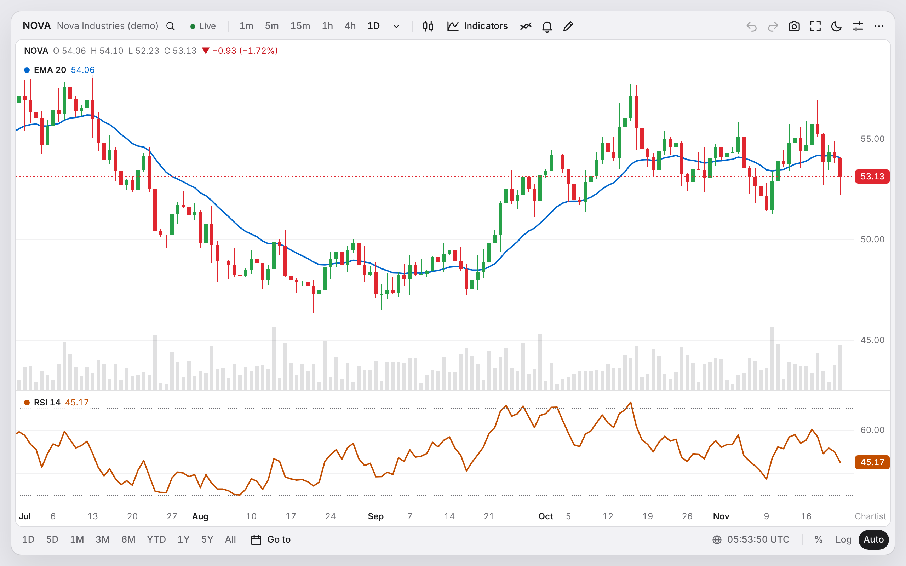</picture></p>

<p align="center"><strong><a href="https://mrchartist.github.io/Lite_Charts/">Live demo and docs</a></strong> · <a href="#quick-start">Quick start</a> · <a href="#a-gallery">Gallery</a> · <a href="#live-bitcoin-in-one-tag">Live Bitcoin</a> · <a href="docs/guide/getting-started.md">Get started</a> · <a href="docs/README.md">All documents</a> · <a href="docs/guide/api-reference.md">API reference</a> · <a href="docs/guide/how-it-compares.md">How it compares</a></p>

<p align="center"><b>85</b> indicators · <b>53</b> drawing tools · <b>16</b> chart types · <b>33.6 KB</b> gzip core · <b>0</b> dependencies · worst p95 <b>5.3 ms</b> of 8.33</p>

## Contents

- [What stands out](#what-stands-out)
- [Quick start](#quick-start) and [a gallery](#a-gallery)
- [Live Bitcoin in one tag](#live-bitcoin-in-one-tag)
- [Try it in 60 seconds](#try-it-in-60-seconds)
- [Install](#install)
- [A tour](#a-tour): [series](#series), [panes](#panes), [indicators](#indicators), [drawing tools](#drawing-tools), [live data](#live-data), [the element](#the-chartist-chart-element), [themes](#themes), [time zones](#time-zones), [accessibility](#accessibility)
- [Recipes](#recipes)
- [Options at a glance](#options-at-a-glance)
- [Performance](#performance) and [sizes](#sizes)
- [How it compares](#how-it-compares)
- [Browser support and what is not verified](#browser-support-and-what-is-not-verified)
- [FAQ](#faq)
- [Documentation](#documentation), [project layout](#project-layout), [scripts](#scripts), [roadmap](#roadmap)
- [Contributing, security and licence](#contributing-security-and-licence), [credits](#credits)

## What stands out

- **A ready-made chart in one call:** `createWidget(el, options)` or `<chartist-terminal>` gives a whole workspace: symbol search, intervals, chart types, a searchable indicators dialog, compare, alerts, drawing tools, undo, screenshot, full screen, range keys and live crypto ([guide](docs/guide/widget.md)).
- **16 chart types,** Renko, Kagi, line break, point and figure and range bars included, each one call to `applyChartType` ([guide](docs/guide/chart-types.md)).
- **85 indicators** in a catalogue a UI can be built on, each proven equal to its own function in the tests ([catalogue](docs/guide/indicator-catalogue.md)).
- **53 drawing tools** in 7 groups, with a toolbar, single-key shortcuts, undo and versioned JSON; the default 15 are a 20.7 KB gzip import ([guide](docs/guide/drawing-tools.md)).
- **120 Hz frame budget, measured:** in 116 scenarios up to 100000 bars, the costliest frame of our code took 5.30 ms at p95 of the 8.33 ms a 120 Hz screen allows; none went over ([how it was measured](docs/PERFORMANCE.md)).
- **Keyboard and screen-reader inspect mode:** Enter steps through bars, each one announced; it works under a strict `style-src 'self'` policy and with hostile page CSS.

Chartist Lite is a small JavaScript library that draws price charts on a single canvas, with a ready-made workspace around it when you want one. It comes as ES modules, a React wrapper, `<chartist-chart>` and `<chartist-terminal>` web components and plain script-tag files. Core 33.6 KB gzip, no runtime dependencies, written from scratch.

**Status: version 0.1.0. Not on npm yet.** Build it from the GitHub repository (see [Install](#install)). Licence: Apache-2.0. Source and issues: [github.com/MrChartist/Lite_Charts](https://github.com/MrChartist/Lite_Charts); documentation site with live charts: [mrchartist.github.io/Lite_Charts](https://mrchartist.github.io/Lite_Charts/).

## Quick start

The whole workspace, in three lines (after [building the files](#install)):

```html
<script src="chartist-lite.terminal.iife.min.js"></script>
<chartist-terminal live symbol="BTC-USD" interval="1h" indicators="ema,rsi" drawings></chartist-terminal>
```

Or from a bundler, with rows of your own:

```js
import { createWidget } from 'lite-charts/widget';
createWidget(document.getElementById('chart'), { data: rows, symbol: 'ACME', indicators: ['ema', 'rsi'] });
```

`live` connects the visitor's browser straight to a public exchange feed (see [Live data](docs/guide/live-data.md)); leave it out and give `src="prices.json"` or `data` instead. Just the canvas: `createChart` in [Getting started](docs/guide/getting-started.md).

## A gallery

Real screenshots of the library. The [documentation site](https://mrchartist.github.io/Lite_Charts/examples.html) runs every one of these live, with tabs and the code.

| The ready-made chart | Chart types |
|---|---|
| 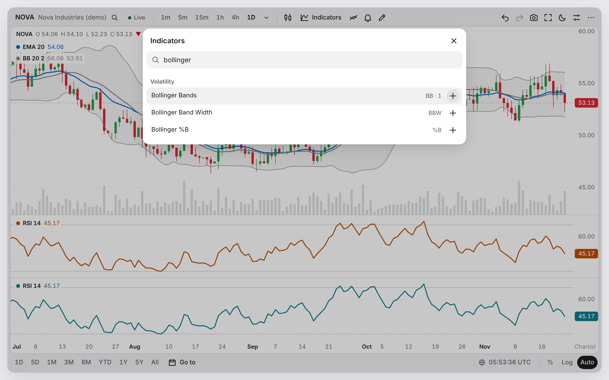 | 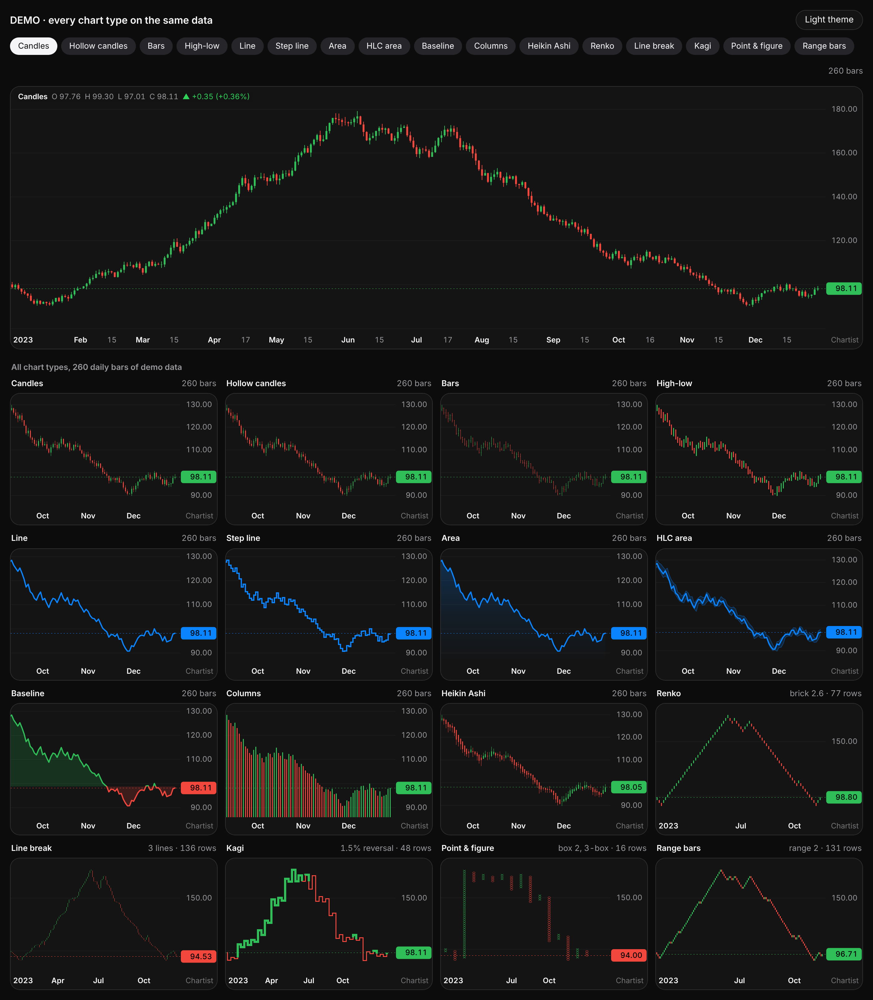 |
| **Tooltips, alerts and more** | **Indicator catalogue** |
| 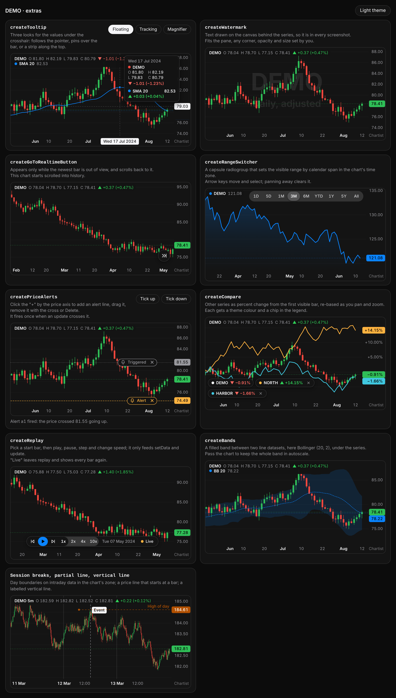 | 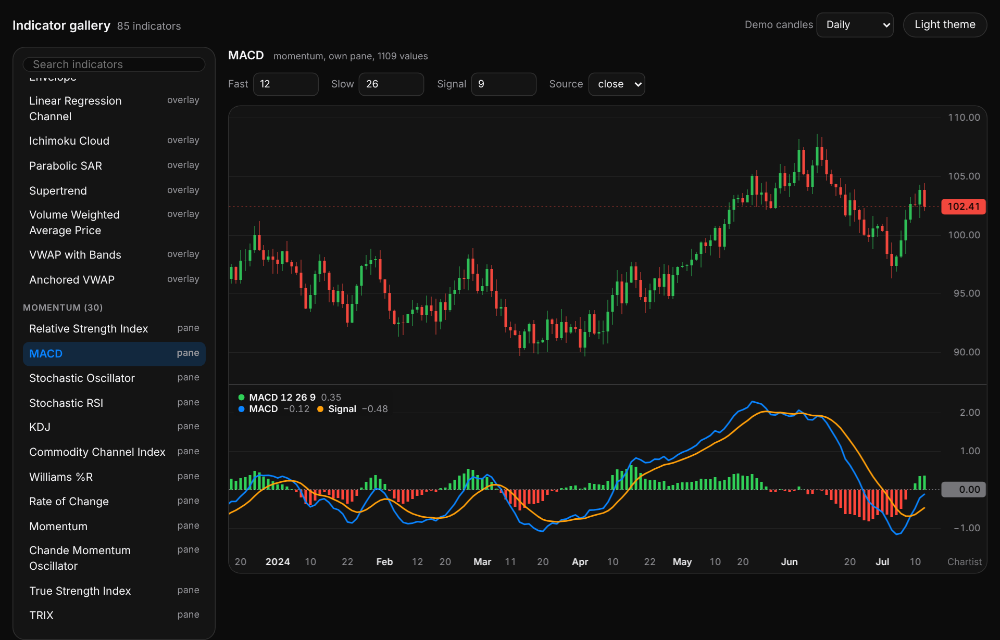 |
| **Every drawing tool** | **Live Bitcoin** |
| 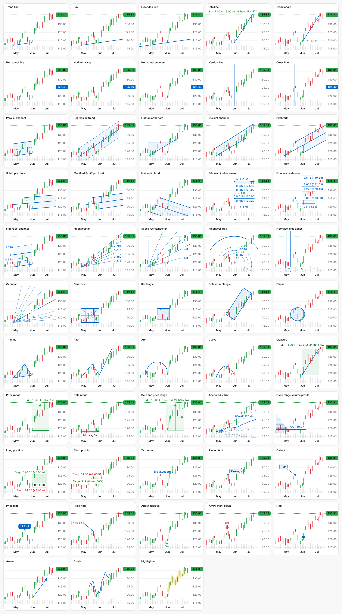 | 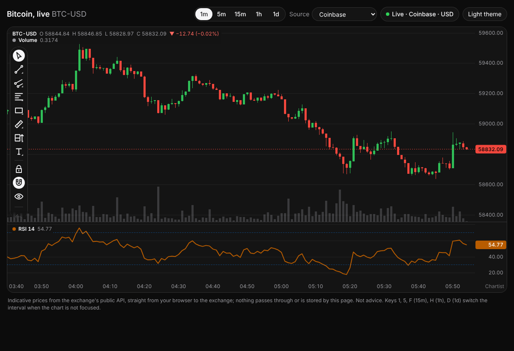 |

## Live Bitcoin in one tag

One script tag and one HTML tag: history, then a live stream from Coinbase's public feed, with volume and a status dot and word. No code, no API key, no server.

```html
<script src="chartist-lite.element-live.iife.min.js"></script>

<chartist-chart live symbol="BTC-USD" interval="1m" provider="coinbase" volume height="420"></chartist-chart>
```

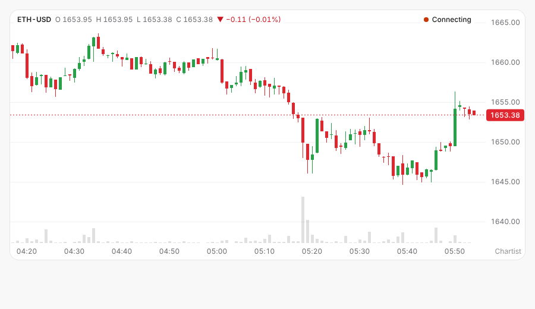

The visitor's browser connects to the exchange directly; nothing passes through a server and nothing is stored. If Coinbase's history does not load, Binance (quoted in USDT, not USD) and then Kraken are tried. Change `symbol` or `interval` and the stream follows. From code, `connectLive(series, { symbol, interval })` in `lite-charts/live` does the same for any series, and a provider of your own can feed any market. Prices are indicative and not advice; using exchange data in a commercial or redistributed product is subject to each exchange's terms (Needs verification, and the embedder's responsibility). The whole story, with the CSP hosts: [Live data](docs/guide/live-data.md).

## Try it in 60 seconds

1. Build once (clone the repository, then `npm ci && npm run build`; see [Install](#install)), or take the two files from `dist/`: `chartist-lite.iife.min.js` and `chartist-lite-indicators.iife.min.js`.
2. Put them in a folder with this file, saved as `chart.html`.
3. Double-click `chart.html`. No server and no data file are needed: the bars are made up in the page.

```html
<!doctype html>
<html lang="en">
<head>
  <meta charset="utf-8">
  <title>My first Chartist Lite chart</title>
  <style>
    body { margin: 0; padding: 24px; font-family: system-ui, sans-serif; background: #141414; }
    #chart { height: 480px; }
  </style>
</head>
<body>
  <div id="chart"></div>

  <script src="chartist-lite.iife.min.js"></script>
  <script src="chartist-lite-indicators.iife.min.js"></script>
  <script>
    // 200 invented daily bars (a random walk), so the page needs no server and no data file.
    const bars = [];
    let close = 100;
    for (let i = 0; i < 200; i++) {
      const day = new Date(Date.UTC(2024, 0, 1 + i)).toISOString().slice(0, 10);
      const open = close;
      close = +(open * (1 + (Math.random() - 0.49) * 0.04)).toFixed(2);
      const high = +(Math.max(open, close) * (1 + Math.random() * 0.01)).toFixed(2);
      const low = +(Math.min(open, close) * (1 - Math.random() * 0.01)).toFixed(2);
      bars.push({ time: day, open, high, low, close });
    }

    const { createChart, CandlestickSeries, LineSeries } = ChartistLite;
    const chart = createChart('chart', { theme: 'dark', ariaLabel: 'Demo daily price' });
    chart.addSeries(CandlestickSeries, { title: 'DEMO' }).setData(bars);
    chart.addSeries(LineSeries, { title: 'SMA 20', color: '#FF9F0A' })
      .setData(ChartistLiteIndicators.sma(bars, 20));
  </script>
</body>
</html>
```

Drag to pan, scroll or pinch to zoom, click the chart and press Enter to step through bars. Then try [the live examples](docs/guide/getting-started.md) or read on.

## Install

Not on npm yet. Two ways work today, both from the GitHub repository:

**1. Script tags.** Clone and build once, then copy the files you need from `dist/` next to your page (or take them from the files attached to a GitHub Release, once one exists):

```bash
git clone https://github.com/MrChartist/Lite_Charts
cd Lite_Charts
npm ci
npm run build        # writes dist/
```

| You want | File from `dist/` (global) |
|---|---|
| The chart | `chartist-lite.iife.min.js` (`ChartistLite`) |
| Indicators | `chartist-lite-indicators.iife.min.js` (`ChartistLiteIndicators`) |
| Drawing tools | `chartist-lite-drawings.iife.min.js` (`ChartistLiteDrawings`) |
| Live prices | `chartist-lite-live.iife.min.js` (`ChartistLiteLive`) |
| The `<chartist-chart>` element | `chartist-lite.element.iife.min.js` (registers the tag) |
| A live `<chartist-chart live>` with no code | `chartist-lite.element-live.iife.min.js` (registers the tag, with the live entry inside) |
| Chart types | `chartist-lite-transforms.iife.min.js` (`ChartistLiteTransforms`) |
| Tooltips, alerts and more | `chartist-lite-extras.iife.min.js` (`ChartistLiteExtras`) |
| The ready-made chart | `chartist-lite-widget.iife.min.js` (`ChartistLiteWidget`) |
| The ready-made chart with live data and drawings, and `<chartist-terminal>` | `chartist-lite.terminal.iife.min.js` (`ChartistLiteTerminal`, registers the tags) |

**2. ES modules, with a bundler.** After building the clone, add it to your project as a local dependency under the name the examples use:

```bash
npm i lite-charts@file:../Lite_Charts     # the path to your built clone
```

Then `import { createChart } from 'lite-charts'` works, as do `lite-charts/indicators`, `lite-charts/drawings`, `lite-charts/live`, `lite-charts/transforms`, `lite-charts/extras`, `lite-charts/widget`, `lite-charts/element` and `lite-charts/react` (React 18 or later). The clone must be built first: `dist/` is not in the repository, so a plain git dependency (`npm i github:MrChartist/Lite_Charts`) would install without it.

React is an optional peer dependency, used only by the React entry. Nothing else is installed with the package. Only the live entry and the builds that bundle it (element-live, terminal) contain code that talks to an exchange; the core, indicators, drawings, transforms, extras, React and plain element entries have none.

<details><summary>Script tag and the web component (no build step)</summary>

```html
<script src="chartist-lite.element.iife.min.js"></script>

<chartist-chart type="candlestick" theme="auto" src="/data/prices.json" height="360"
  time-zone="Asia/Kolkata" aria-label="Daily price"></chartist-chart>
```

The data can be a URL (JSON or CSV), an inline `<script type="application/json">` or a `.data` property. The chart is created when the element nears the viewport.

</details>

<details><summary>ES module and createChart</summary>

```js
import { createChart, CandlestickSeries, LineSeries } from 'lite-charts';
import { sma } from 'lite-charts/indicators';

const chart = createChart('chart', { theme: 'auto', ariaLabel: 'Daily price' });
const candles = chart.addSeries(CandlestickSeries, { title: 'DEMO' });
const average = chart.addSeries(LineSeries, { title: 'SMA 20', lineWidth: 2 });

candles.setData(bars);          // [{ time: '2024-01-02', open, high, low, close }, ...]
average.setData(sma(bars, 20));
```

The container needs a height in CSS; the chart fills it and follows its size.

</details>

<details><summary>React</summary>

```jsx
import * as React from 'react';
import { createChartistReact } from 'lite-charts/react';

export const { ChartistChart } = createChartistReact(React);

function Price({ candles, average }) {
  return (
    <ChartistChart
      height={420}
      ariaLabel="Daily price"
      options={{ theme: 'auto' }}
      series={[
        { id: 'price', type: 'candlestick', data: candles },
        { id: 'sma', type: 'line', data: average, options: { lineWidth: 2 } },
      ]}
    />
  );
}
```

</details>

<details><summary>Drawing tools</summary>

```js
import { createDrawingTools } from 'lite-charts/drawings';

const tools = createDrawingTools(chart, candles, { toolbar: true });
tools.add({ tool: 'horizontal', points: [{ time: '2024-06-03', price: 104.9 }], text: 'Resistance' });
localStorage.setItem('my-chart', tools.exportJSON());
```

</details>

## A tour

Real screenshots of the library, drawn from invented demo data.

### Series

Candlestick, OHLC bar, line, area, histogram and baseline. Every type takes the same `{ time, ... }` rows and follows the theme. [Series types](docs/guide/series-types.md)

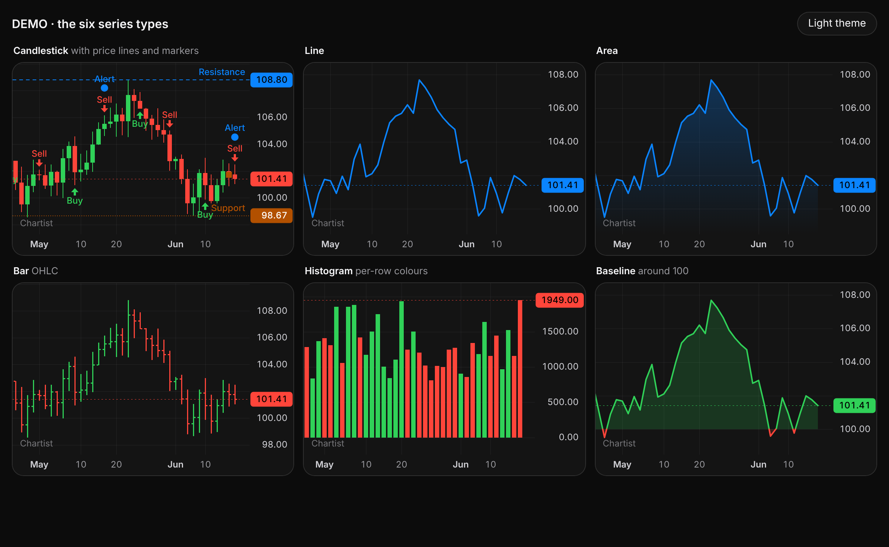

### Panes

Pass a pane index to `addSeries` and RSI gets its own pane, scale and height, sharing the time axis and the crosshair. Volume sits on an overlay scale at the foot of the price. [Panes and scales](docs/guide/panes-and-scales.md)


### Indicators

85 indicators in five categories (trend, momentum, volatility, volume and other), from SMA, EMA, VWAP and Bollinger bands to Ichimoku, Supertrend, MACD, RSI and the stochastics, as plain functions that return rows aligned with your bars, and as a catalogue with declared inputs and outputs that a UI can be built on. [Indicators](docs/guide/indicators.md), [the catalogue](docs/guide/indicator-catalogue.md)

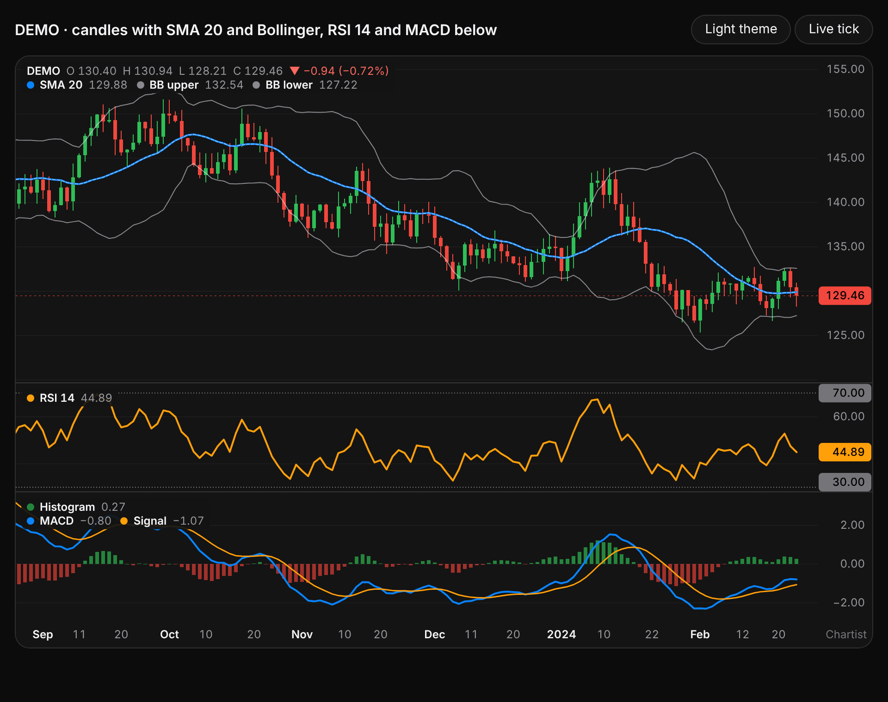

### Drawing tools

53 tools in 7 groups: lines, channels and pitchforks, Fibonacci and Gann, shapes, measures (with anchored VWAP and a volume profile), long and short positions, and notes, on a grouped rail with flyouts and single-key shortcuts (T, H, V, R, F, M, L, S, A, N, B). The default toolbar offers the first 15; pass `tools: ALL_TOOLS` for all. Undo, redo, events and versioned JSON. [Drawing tools](docs/guide/drawing-tools.md)

| The rail and a few drawings | A flyout menu |
|---|---|
| 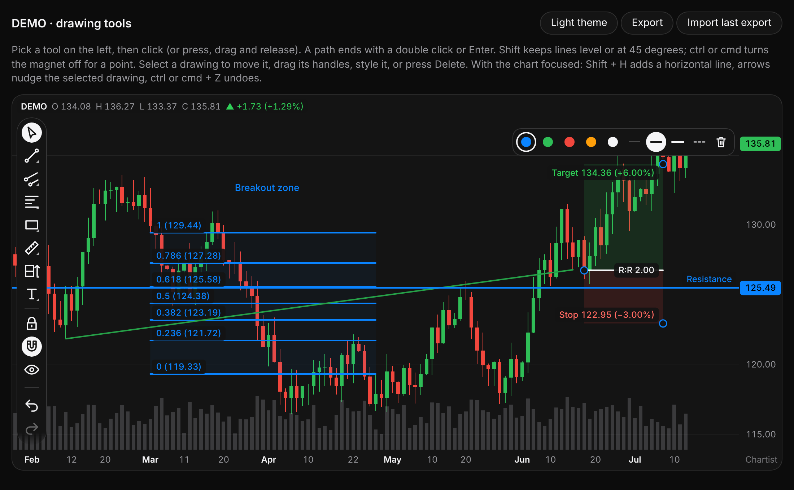 | 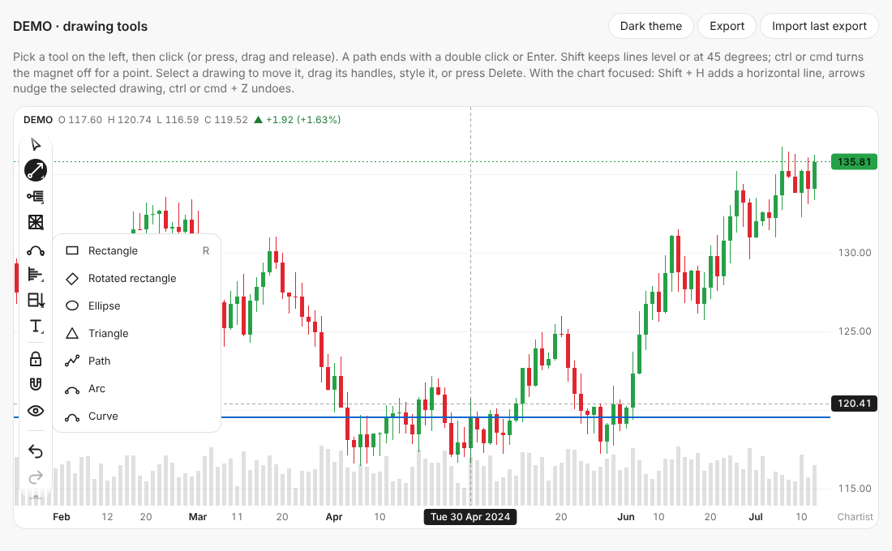 |

### Live data

`connectLive(series, { symbol, interval, provider })` fills a series with history and streams Coinbase, Binance or Kraken into it, once per frame however fast trades arrive. It reconnects with backoff and fills the gap, pauses while the tab is hidden, loads older bars at the left edge, and reports its state as `connecting`, `live`, `reconnecting`, `offline` or `error`. Here the example page `examples/bitcoin.html` adds RSI and the drawing toolbar. [Live data](docs/guide/live-data.md)


### The chartist-chart element

One script tag and one HTML tag, with no code. The table inside the tag is what crawlers and visitors without JavaScript read. [Embedding the chart](docs/guide/embedding.md)


### Themes

Light, dark and auto (follows the visitor's system setting), colour overrides, and a switch at runtime with `chart.applyOptions({ theme })`. [Theming](docs/guide/theming.md)

| Light | Dark |
|---|---|
| 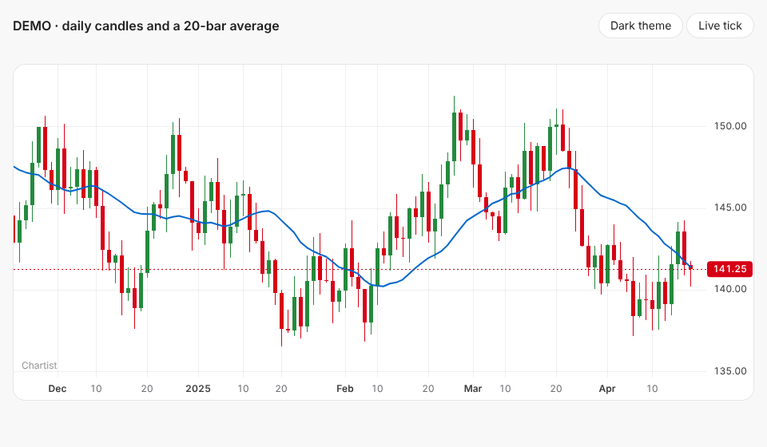 | 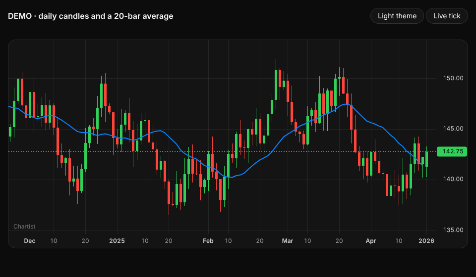 |

### Time zones

The axis has one slot per bar, so nights and weekends take no space; ticks land on session and calendar boundaries, and labels read in any IANA zone. Here five sessions of five-minute bars from Asia/Kolkata are labelled in New York time. [Time and time zones](docs/guide/time-and-time-zones.md)

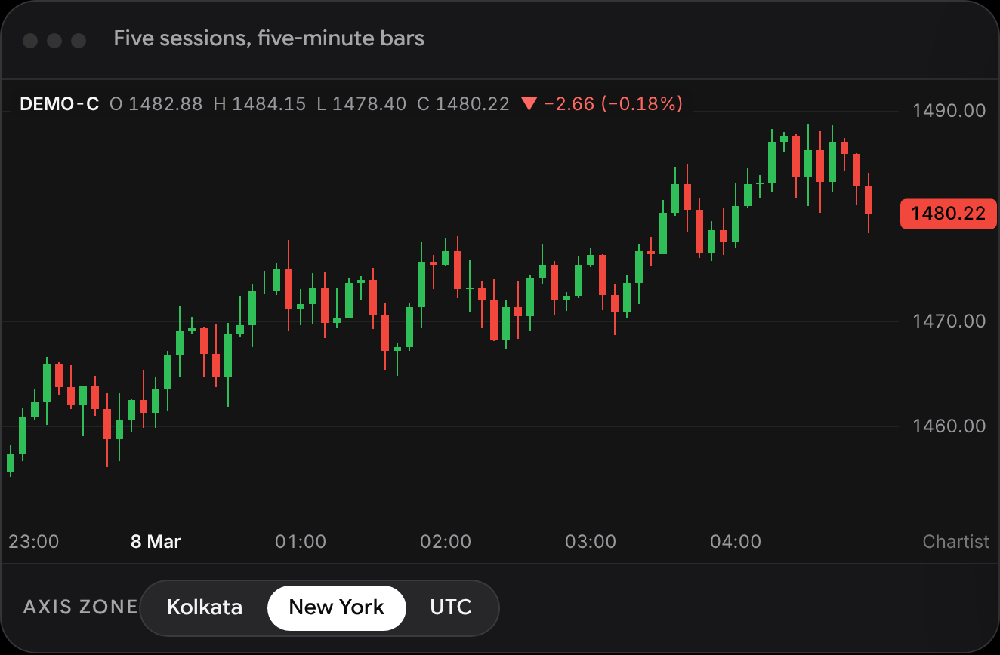

### Accessibility

The chart takes focus and has a name and spoken help. Arrows pan, plus and minus zoom, and Enter starts stepping through bars; each bar is announced through a live region, for example "Thu 18 Apr 2024; DEMO: open 98.43, high 100.32, low 97.41, close 99.96". [Accessibility](docs/guide/accessibility.md)

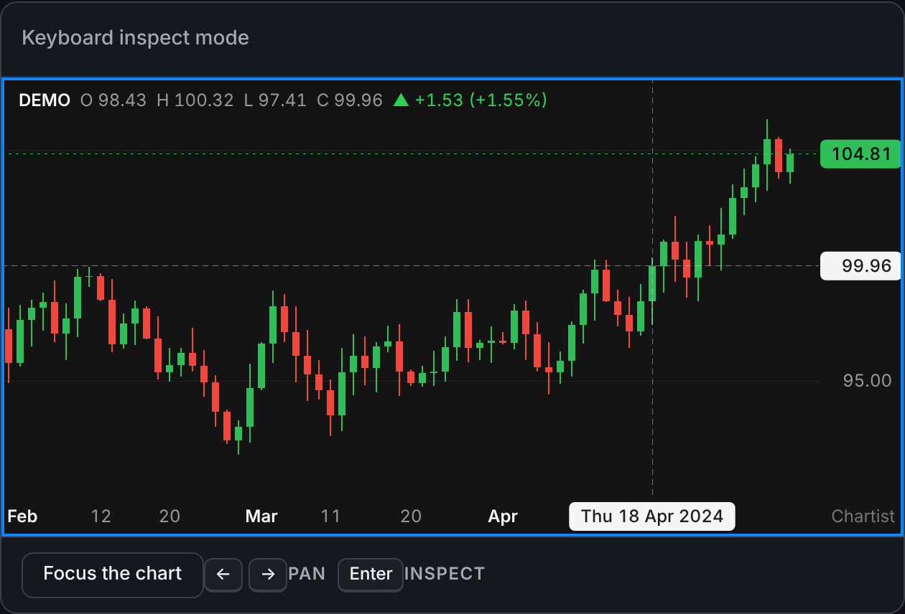

## Recipes

<details><summary>Volume under the price</summary>

```js
const volume = chart.addSeries(HistogramSeries, { priceScaleId: 'volume', title: 'Volume' });
chart.priceScale('volume').applyOptions({ scaleMargins: { top: 0.8, bottom: 0 } });
volume.setData(bars.map(b => ({ time: b.time, value: b.volume })));
```

An overlay scale (any id other than `'right'` and `'left'`) gives volume its own range without squeezing the price.

</details>

<details><summary>An RSI pane under the price</summary>

```js
import { rsi } from 'lite-charts/indicators';

const rsiLine = chart.addSeries(LineSeries, { title: 'RSI 14' }, 1);   // pane 1: a new pane below
rsiLine.setData(rsi(bars, 14));
createPriceLine(rsiLine, { price: 70, lineStyle: 'dotted' });
createPriceLine(rsiLine, { price: 30, lineStyle: 'dotted' });
```

</details>

<details><summary>Live updates with update()</summary>

```js
import { createIndicator } from 'lite-charts/indicators';

const rsi14 = createIndicator('rsi', { period: 14 });
rsi14.seed(history);                      // warm up on the bars you already have

function onTick(bar) {                    // bar: { time, open, high, low, close }
  candles.update(bar);                    // same time: replaces the last bar; newer: appends
  rsiLine.update(rsi14.next(bar));        // the same cost per tick, however long the history
}
```

</details>

<details><summary>Save and restore drawings</summary>

```js
const tools = createDrawingTools(chart, candles, { toolbar: true, persist: { key: 'chart-1' } });
// or by hand:
localStorage.setItem('chart-1', tools.exportJSON());
tools.importJSON(localStorage.getItem('chart-1'));   // returns how many drawings were loaded
```

Times are stored as UNIX seconds, so drawings stay put through zoom, resize, a time zone change and new data.

</details>

<details><summary>React with live data</summary>

```jsx
const { ChartistChart } = createChartistReact(React);

function Live({ bars }) {   // pass a new array each tick; only the changed last bars go to update()
  return <ChartistChart height={360} series={[{ id: 'p', type: 'candlestick', data: bars }]} />;
}
```

Treat the arrays as immutable: changing an array in place is not seen.

</details>

<details><summary>A custom price and time format</summary>

```js
createChart('chart', {
  localization: {
    priceFormatter: p => `₹${p.toFixed(2)}`,      // axis, last value, crosshair and legend
    hours12: true,
    dateOrder: 'month-day',
  },
});
```

The built-in text never groups digits and writes negatives with the true minus sign (`−2.35`).

</details>

<details><summary>Dark and light following your page</summary>

```js
// The page sets <html data-theme="dark|light">; the chart follows it.
const sync = () => chart.applyOptions({ theme: document.documentElement.dataset.theme === 'dark' ? 'dark' : 'light' });
new MutationObserver(sync).observe(document.documentElement, { attributes: true, attributeFilter: ['data-theme'] });
sync();
```

If your page follows the system setting instead, `theme: 'auto'` does it with no code.

</details>

<details><summary>Many charts on one page</summary>

```html
<script src="chartist-lite.element.iife.min.js"></script>
<chartist-chart type="line" src="/data/a.csv" height="200"></chartist-chart>
<chartist-chart type="line" src="/data/b.csv" height="200"></chartist-chart>
<!-- each chart is created only when it comes within 200 px of the viewport, and released when removed -->
```

With `createChart`, call `chart.remove()` when a chart leaves the page to release its observers.

</details>

<details><summary>A page with a strict Content-Security-Policy</summary>

```text
Content-Security-Policy: default-src 'self'; script-src 'self'; style-src 'self'
```

Load the library and your own code from files, not inline scripts. The chart writes its styles through the CSSOM, and `<chartist-chart>` adopts a constructable stylesheet, so neither needs `'unsafe-inline'` (checked in Chromium; Safari before 16.4 falls back to a `<style>` element that this policy blocks).

</details>

## Options at a glance

Pass these to `createChart(container, options)` or `chart.applyOptions(options)`. Every option and type: [API reference](docs/guide/api-reference.md).

| Chart option | Default | What it does |
|---|---|---|
| `theme` | `'light'` | `'light'`, `'dark'` or `'auto'` (follows the system setting) |
| `colors` | `{}` | Override any theme colour, such as `{ up, down, background }` |
| `fontFamily`, `fontSize` | system stack, 12 | Text of the axes and legend; never below 12 px |
| `grid` | `{ vertLines: false, horzLines: true }` | Grid lines |
| `crosshair` | `{ mode: 'normal', labels: true }` | `'normal'`, `'magnet'` or `'hidden'` |
| `timeScale` | `{ barSpacing: 8, rightOffset: 2, timeZone: 'UTC' }` | Bar spacing, empty bars at the right, the axis time zone |
| `rightPriceScale`, `leftPriceScale` | `mode: 'linear'`, margins 0.1 | `'linear'`, `'log'` or `'percent'`, autoscale and margins |
| `localization` | `{ hours12: false, dateOrder: 'day-month', noDataText: 'No data' }` | Clock, date order, formatters, empty-chart text |
| `interaction` | `wheelZoom: 'auto'`, the rest on | Wheel, drag, pinch, kinetic glide, keyboard, double-click reset |
| `legend` | `{ visible: true }` | The legend at the top left of each pane |
| `attribution` | `{ visible: true, position: 'axis-corner' }` | The small "Chartist" link; `false` hides it |
| `ariaLabel`, `ariaDescription` | `'Price chart'`, the keyboard help | The chart's accessible name and spoken help |
| `autoSize`, `width`, `height` | `true`, 0, 0 | Follow the container, or a fixed size |

| Every series | Default | What it does |
|---|---|---|
| `title` | none | Name in the legend and the spoken description |
| `priceScaleId` | `'right'` | `'right'`, `'left'` or an overlay scale id |
| `priceFormat` | `{ precision: 2 }` | Decimals and the smallest price step (`minMove`) |
| `visible`, `lastValueVisible`, `priceLineVisible` | `true` | Show the series, its last-value tag and its price line |

| Drawing tools (`createDrawingTools(chart, series, options)`) | Default | What it does |
|---|---|---|
| `toolbar` | `false` | `true` or `{ position: 'left' \| 'top' }` for the built-in rail |
| `tools` | `BASIC_TOOLS` (15) | `ALL_TOOLS` for all 53, or any list of tool definitions |
| `magnet` | `true` | Snap points to open, high, low or close |
| `keepDrawing` | `false` | Stay on the tool after a drawing is finished |
| `defaultStyle` | theme line colour, width 2, solid | Style of new drawings |
| `persist` | off | `{ key }`: save after every change and load at start |

The element's attributes (`type`, `theme`, `height`, `time-zone`, `volume`, `attribution`, `src`, `loading`, `aria-label`) are in [Embedding the chart](docs/guide/embedding.md#attributes); the live ones (`live`, `symbol`, `interval`, `provider`) and every `connectLive` option are in [Live data](docs/guide/live-data.md). Every `createWidget` option is in [The ready-made chart](docs/guide/widget.md).

## Performance

From `npm run bench` ([PERFORMANCE.md](docs/PERFORMANCE.md), raw numbers in `docs/performance.json`), run on 22 November 2026 on an Intel Xeon at 2.30 GHz (4 cores), Chromium 157 headless. Each figure is the **cost of one frame of our code**: the input handlers, the chart's frame callbacks and the layout of the legend, 200 frames per scenario after 20 warm-up frames, over a plain chart, one with three indicators and two extra panes, one with 20 drawings of every tool, a live chart fed 20 Coinbase trade messages a frame through the live entry (everything but the network) and the ready-made widget with three indicators, at device pixel ratios 1 and 2.

| Worst p95, ms | 1000 bars | 10000 bars | 100000 bars |
|---|---|---|---|
| Crosshair | 1.10 | 1.10 | 1.30 |
| Pan | 0.70 | 0.80 | 0.70 |
| Wheel zoom | 1.80 | 2.80 | 4.40 |
| Live tick | 0.80 | 0.70 | 0.70 |
| Live tick, whole series in view | 1.10 | 2.20 | 5.30 |
| Drag a drawing | 0.50 | 0.50 | 0.50 |
| Live trades, 20 a frame | 0.50 | 0.50 | 0.50 |

0 of 116 scenarios had a p95 over 8.33 ms (one frame at 120 Hz) or over 6.94 ms (144 Hz). What this is not: a frame rate on a real 120 Hz panel, GPU time, canvas rasterisation or input latency (headless Chromium has no GPU and runs animation frames at about 60 Hz). Measure on your own hardware; the documentation site has a frame meter that times the chart on the device that opens it.

**Run it yourself:** `npm run bench` builds the package and writes `docs/performance.json` and `docs/PERFORMANCE.md`; `node scripts/bench.cjs --quick` runs 1000 and 100000 bars at one pixel ratio. It needs Playwright importable (it is not a dependency of the package) and exits with code 1 when any p95 is over 8.33 ms. Numbers move with the machine, so compare runs on one machine.

## Sizes

You load what you need: every part is its own entry. Bundled and minified with esbuild as a bundler would, then gzip (level 9) and brotli (quality 11) with Node's zlib, by the documentation site's build on the 0.1.0 working tree (`npm run size` prints the gzip column):

| Import or file | What it brings | gzip | brotli |
|---|---|---|---|
| `lite-charts` | `createChart`, the six series, price lines, markers, themes, legend, keyboard | 33.6 KB | 29.7 KB |
| `lite-charts/indicators` | 85 indicators and the catalogue; import one function to keep only it | 21.6 KB | 19.2 KB |
| `lite-charts/drawings` | `createDrawingTools` with the default 15 tools, toolbar, undo, JSON | 20.7 KB | 18.5 KB |
| `lite-charts/drawings` with `ALL_TOOLS` | All 53 tools in 7 groups | 31.8 KB | 27.5 KB |
| `lite-charts/live` | `connectLive` and the Coinbase, Binance and Kraken providers | 6.2 KB | 5.6 KB |
| `lite-charts/transforms` | 16 chart types: Renko, Kagi, point and figure, line break, range bars and more | 12.4 KB | 11.1 KB |
| `lite-charts/extras` | Tooltips, watermark, alerts, compare, replay, bands, custom series | 26.4 KB | 23.7 KB |
| `lite-charts/widget` | The ready-made chart (includes the chart); drawings and live load on demand | 91.2 KB | 78.4 KB |
| `lite-charts/element` | The `<chartist-chart>` tag (includes the chart) | 37.3 KB | 32.8 KB |
| `lite-charts/react` | A component and a hook (includes the chart) | 33.1 KB | 29.3 KB |
| `chartist-lite.terminal.iife.min.js` | One script tag: the widget with chart types, live data and drawing tools, and the tags | 132.7 KB | 112.2 KB |

What three typical pages load:

| Page | gzip | brotli |
|---|---|---|
| Core only: `createChart` and candlesticks | 28.3 KB | 25.1 KB |
| Candles, two averages and RSI (`sma`, `ema`, `rsi`) | 30.1 KB | 26.6 KB |
| The full terminal, one script tag | 132.7 KB | 112.2 KB |

The core has a 34 KB gzip budget that `npm run size` enforces.

## How it compares

Using only figures each project publishes about itself; every figure, its source and the date it was read are on [How it compares](docs/guide/how-it-compares.md).

| | Chartist Lite | TradingView Lightweight Charts | OpenAlgo Charts |
|---|---|---|---|
| Licence | Apache-2.0 | Apache 2.0 | Apache-2.0 |
| Size stated | core 33.6 KB gzip, 29.7 KB brotli (measured) | "35 KB" (compression not stated) | core 141.88 kB brotli |
| Full workspace | 112.2 KB brotli (terminal build) | not stated | 380.39 kB brotli |
| Chart types | 16 | candles, line, bars, area, baseline, histogram, plus custom | 13 |
| Indicators | 85 | not stated | 112 |
| Drawing tools | 53 | not stated | 90 |
| Order flow, trading tickets | none | not stated | stated |
| On npm | not yet | not stated on its page | `npm i openalgo-charts` |
| Measured frame budget | worst p95 5.3 ms of 8.33 | not stated | not stated |

Sources: tradingview.com/lightweight-charts and openalgo.in/charts, both read on 2026-11-22. OpenAlgo Charts states more indicators and drawing tools, order flow and trading on the chart; both others install today and Lightweight Charts states wide use; Chartist Lite is new. All trademarks belong to their owners; Chartist Lite is not affiliated with either project.

## Browser support and what is not verified

Tested in Chromium on Linux, driven by Playwright: the example pages draw with no console errors in light and dark, including a page with a strict Content-Security-Policy (`style-src 'self'`), right-to-left text and hostile global CSS. 555 unit tests pass (`npm test`), the live entry's among them: its parsers on real exchange messages and its streaming against a fake socket. The library uses the canvas 2D API and `ResizeObserver`; the element also uses custom elements and `IntersectionObserver` (without it, the chart is created at once).

Not verified yet:

- Firefox and Safari (including Safari before 16.4, where the element falls back to a `<style>` element that a strict CSP blocks).
- Real touch devices: pinch, one-finger pan, tap crosshair, the pane divider, and drawing by touch (only Chromium's touch emulation was run).
- Screen readers: no VoiceOver, NVDA or JAWS run is recorded; the roles and the live region are implemented but unverified with assistive technology.
- Fractional device pixel ratios such as 1.25 and 1.5 (only 1 and 2 were rendered).
- A real 120 Hz or 144 Hz display, and GPU time (the bench runs headless).
- React 18 (the React entry was run with React 19 only).
- The live entry in browsers other than Chromium, over sessions of many hours, and the exchanges' terms for commercial or redistributed use (Needs verification; the embedder's responsibility).
- The contrast ratio of every built-in colour pair, and whether the custom series contract is a stable public API.

## FAQ

### Is it free?

Yes. Chartist Lite is open source under the Apache-2.0 licence, which allows personal and commercial use, changes and redistribution. When you redistribute it, keep the `LICENSE` and `NOTICE` files with your copy.

### Can I remove the attribution link?

Yes. The small "Chartist" link under the price axis is an option: `attribution: false` hides it (on the element, `attribution="false"`), and `attribution: { position: 'bottom-left' }` moves it. The licence does not require a link on the chart. Keeping it is appreciated.

### Does it fetch data?

The core: never. It draws the rows you give it and makes no network requests of its own, and neither do the indicators, drawings, React and plain element entries; `<chartist-chart src="...">` fetches only the JSON or CSV file you point it at. The live entry: only when you use it. `connectLive(...)` or a `<chartist-chart live>` tag (element-live build) connects the visitor's browser straight to the exchange you chose (Coinbase, Binance or Kraken), with no key and no server in between; history requests carry no cookies. Nothing phones home, and nothing is stored unless you turn on the drawing tools' `persist` option. For a strict CSP, the `connect-src` hosts are listed in [Live data](docs/guide/live-data.md#strict-content-security-policy).

### How is it different from the full Chartist chart?

Chartist Lite was started inside the Mr. Chartist app (Scanner Pro), whose chart is part of a larger trading product with its own data, accounts and app settings. A few rules and algorithms were ported from that app's chart engine and made independent of it: no market data, no app settings, no imports from outside this package. Everything else was written for Chartist Lite. `PROVENANCE.md` lists each ported piece and what changed.

### Is it affiliated with TradingView?

No. Chartist Lite is an independent project, not affiliated with, endorsed by or derived from TradingView or any other charting product, and it contains no code from other charting libraries. Many public names (`createChart`, `addSeries`, `setData`, `update`) follow TradingView's Lightweight Charts on purpose, so code moves over easily.

### How do I migrate from Lightweight Charts?

Most of it is mechanical: series are added with `chart.addSeries(CandlestickSeries, options, paneIndex)`, times are UNIX seconds or business days, and price scale modes are strings. [Coming from Lightweight Charts](docs/guide/coming-from-lightweight-charts.md) lists every difference that can surprise you.

## Documentation

All documents on one screen: [docs/README.md](docs/README.md). The guides, by task:

| Start | Build the chart | Make it yours | Reference |
|---|---|---|---|
| [Getting started](docs/guide/getting-started.md) | [Series types](docs/guide/series-types.md) | [Theming](docs/guide/theming.md) | [API reference](docs/guide/api-reference.md) |
| [The ready-made chart](docs/guide/widget.md) | [Chart types](docs/guide/chart-types.md) | [Tooltips, alerts and more](docs/guide/extras.md) | [Indicator catalogue](docs/guide/indicator-catalogue.md) |
| [Embedding the chart](docs/guide/embedding.md) | [Indicators](docs/guide/indicators.md) | [Plugins and primitives](docs/guide/plugins.md) | [Coming from Lightweight Charts](docs/guide/coming-from-lightweight-charts.md) |
| | [Panes and scales](docs/guide/panes-and-scales.md) | [Accessibility](docs/guide/accessibility.md) | [How it compares](docs/guide/how-it-compares.md) |
| | [Time and time zones](docs/guide/time-and-time-zones.md) | | [Performance](docs/PERFORMANCE.md) |
| | [Drawing tools](docs/guide/drawing-tools.md) | | |
| | [Live data](docs/guide/live-data.md) | | |

A documentation site with live charts, search and a frame meter is built from these files and published at [mrchartist.github.io/Lite_Charts](https://mrchartist.github.io/Lite_Charts/); to build it yourself, `npm run build && npm run site`, then open `site/dist/index.html`. To publish it for free, see [site/README.md](site/README.md).

## Project layout

```text
src/
  index.ts          the main entry: createChart, series, plugins, themes, formatting
  api.ts            the public interfaces (ChartApi, SeriesApi, TimeScaleApi, ...)
  chart/            the chart: layout, input, legend, panes
  core/             options, themes, time, time zones, number formatting
  scales/           time and price scales and their ticks
  series/           the six series types and the series contract
  render/           canvas, crisp pixels, decimation, text
  plugins/          price lines, markers, the primitive contract
  indicators/       the indicators entry
  drawings/         the drawing tools entry
  live/             the live data entry: connectLive and the exchange providers
  transforms/       the chart types entry: CHART_TYPES, applyChartType, Renko and the other transforms
  plugins/extras/   the extras entry: tooltips, watermark, alerts, compare, replay, bands, custom series
  widget/           the ready-made chart and <chartist-terminal>
  element/          the <chartist-chart> entry
  react/            the React entry
docs/guide/         the guides (also the source of the site)
docs/screenshots/   screenshots used here and in the guides
examples/           standalone example pages, including a hostile page and a React app
scripts/            build, size, bench and screenshot scripts
site/               the documentation site builder and its checks
```

How the pieces fit: [ARCHITECTURE.md](ARCHITECTURE.md).

## Scripts

| Command | What it does |
|---|---|
| `npm run build` | Builds `dist/`: ES modules per entry, type declarations and the minified script-tag files |
| `npm test` | Runs the unit tests (Vitest) |
| `npm run typecheck` | Type-checks the source |
| `npm run size` | Prints each entry's size, gzipped, and fails when the core goes over 34 KB |
| `npm run bench` | Builds, then measures frame cost against 120 Hz and 144 Hz; writes `docs/PERFORMANCE.md` |
| `npm run screenshots` | Builds, then shoots every screenshot in `docs/screenshots/` |
| `npm run site` | Builds the documentation site into `site/dist/` (needs `npm run build` first) |
| `npm run check` | Type check, tests, build and size, in that order |

`bench`, `screenshots` and the site's own check (`node site/check.cjs`) need Playwright importable; it is not a dependency of the package.

## Roadmap

Not built yet, from the feature notes:

- Publishing to npm (version 0.1.0 is built from source today).
- Per-bar colours on candles, candle borders and hollow candles.
- Dragging a series between panes with the pointer, and collapsing or maximising a pane.
- A pane title row (the legend covers names and values today).
- Verification on Firefox, Safari, real touch devices and screen readers (see [what is not verified](#browser-support-and-what-is-not-verified)).

## Contributing, security and licence

- **Contributing:** read [CONTRIBUTING.md](CONTRIBUTING.md) and [ARCHITECTURE.md](ARCHITECTURE.md). The rules in short: no runtime dependencies, no import from outside the package, no code copied from other charting libraries, tests for pure logic, and light and dark screenshots for visual changes. Changes are listed in [CHANGELOG.md](CHANGELOG.md).
- **Issues:** bugs and ideas go to [GitHub issues](https://github.com/MrChartist/Lite_Charts/issues).
- **Security:** report problems privately, as [SECURITY.md](SECURITY.md) describes; do not open a public issue.
- **Conduct:** [CODE_OF_CONDUCT.md](CODE_OF_CONDUCT.md).
- **Licence:** Apache-2.0. See `LICENSE` and `NOTICE`. Copyright 2026 Mr. Chartist, https://mrchartist.com.

## Credits

Written by Mr. Chartist, https://mrchartist.com. Where each part came from: [PROVENANCE.md](PROVENANCE.md). Development tools: TypeScript, Vitest and esbuild; the checks and screenshots run in Chromium through Playwright.

The documentation site uses the Mr. Chartist type: Chartist Sans Flex (from Google Sans Flex by Google), Chartist Sans (from Plus Jakarta Sans by Tokotype) and Chartist Serif (from Instrument Serif by Instrument), under the SIL Open Font License 1.1, with symbols from Inter. The fonts ship only with the site, not with the library.
